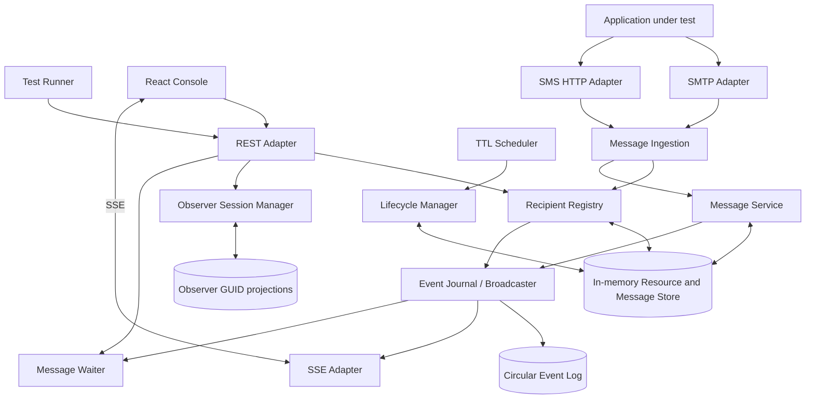

# Big-block architecture

The server is a **single-process modular Node.js/TypeScript application**, not a distributed system.

## Component responsibilities

| Component | Sole responsibility |
| --- | --- |
| SMTP Adapter | Negotiate SMTP and parse incoming MIME; never own domain state |
| SMS HTTP Adapter | Validate and admit simulated SMS |
| REST Adapter | Request validation, HTTP status codes and serialization |
| Recipient Registry | Create, validate, locate and delete recipients |
| Message Ingestion | Resolve recipient or anomaly destination and normalize deliveries |
| Message Service | Store, list, query and delete messages |
| Message Waiter | Wait on predicate and timeout without consuming messages |
| Observer Session Manager | GUID lifetime, attachments and observer snapshot |
| Observer projection | Set of inbox IDs observed by each GUID |
| Event Journal | Sequence, ring-buffer and broadcast operational changes |
| SSE Adapter | Replay, gaps, reset, heartbeats and real-time streaming |
| Lifecycle Manager | Expire inboxes and cascade deletion |
| TTL Scheduler | Trigger lifecycle processing periodically |
| Memory Store | Store only in process RAM; restart clears everything |

The initial implementation co-locates domain capabilities inside `src/core.ts`, with the adapter boundary in `src/server.ts`. Further module extraction should preserve these responsibilities without introducing unnecessary infrastructure.

## Event semantics

Messages in the store are authoritative. SSE notifications are hints to refresh/synchronize projection, not full message data. Global logs use a bounded circular array with run ID and monotonic sequence. Observer sessions are logical sessions, not TCP sockets; one GUID may reconnect on another SSE connection.

A single process is assumed. If eventually scaling to several instances, both state storage and event fanout will need a coordinated redesign.
